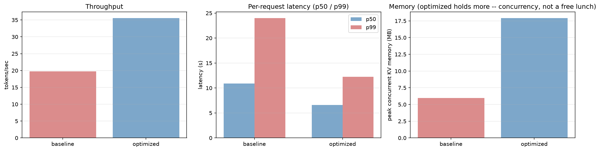
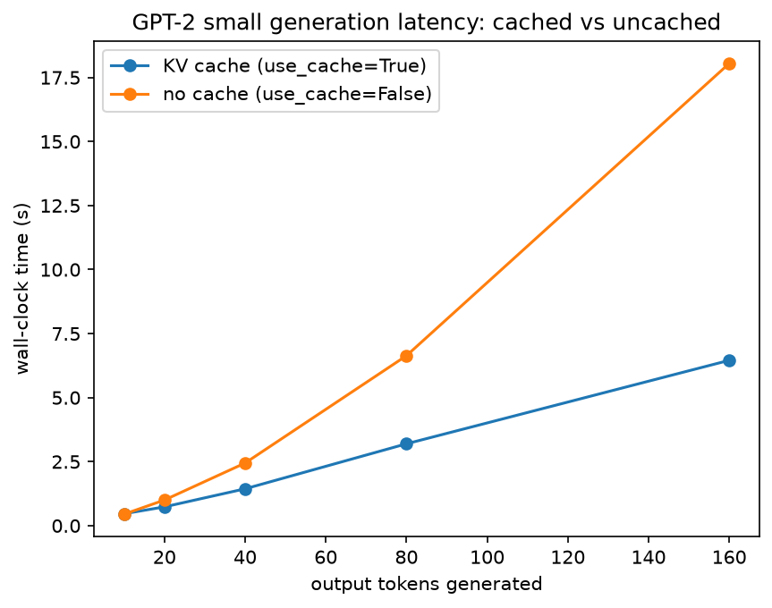
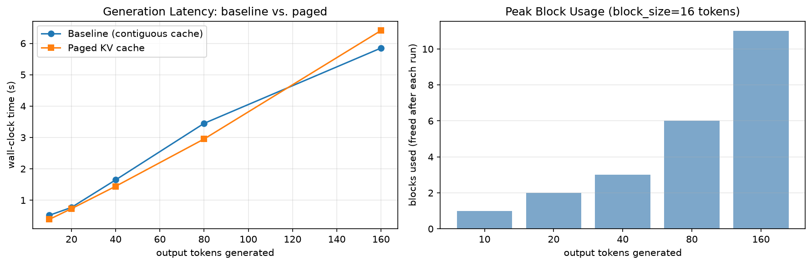
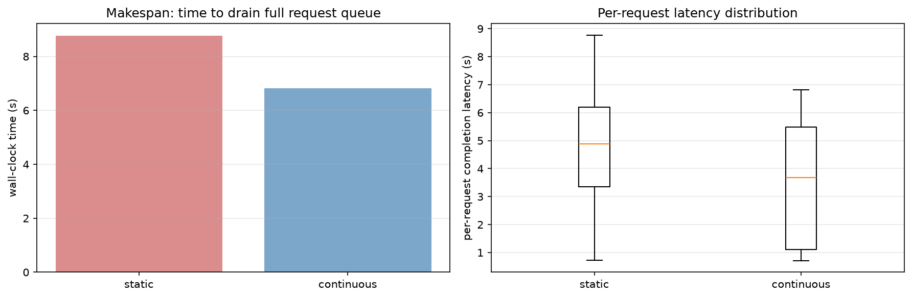
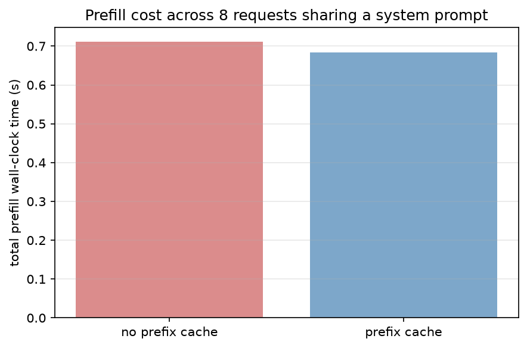

# kv-cache-engine

A small inference engine that reimplements the memory-management and
scheduling techniques behind production LLM servers (vLLM, SGLang):
incremental KV caching, continuous batching, and prefix caching —
served over a FastAPI endpoint with streaming responses.

Base model: GPT-2 small (124M), run on CPU. All six milestones below
are complete, and every optimized code path was verified token-for-token
against standalone greedy generation before being benchmarked.



## Results at a glance

14-request workload (8 sharing a system prompt, 6 standalone; mixed
short/long output lengths) — baseline (sequential, one request at a
time, no batching, no prefix reuse) vs. optimized (incremental KV
caching + continuous batching + prefix caching, combined):

| metric | baseline | optimized | change |
|---|---|---|---|
| throughput | 19.75 tok/s | 35.58 tok/s | **1.80x** |
| p50 latency | 10.90s | 6.58s | **1.66x faster** |
| p99 latency | 24.02s | 12.26s | **1.96x faster** |
| peak concurrent KV memory | 5.98 MB | 17.93 MB | ~3x higher |
| prefix cache hit rate | n/a | 87.5% (7/8 eligible) | — |

The memory increase is an honest, expected tradeoff, not a regression:
it comes from holding up to 4 sequences concurrently in flight, which
is exactly what buys the throughput and latency wins. Wall-clock
numbers on this CPU/GPT-2-small setup carry some run-to-run scheduling
noise; relative orderings were consistent across repeated runs,
absolute magnitudes were not perfectly stable.

## Milestones

### 1. Baseline

Naive full KV cache via HF `transformers`, measuring latency with and
without `use_cache` as the reference point every later milestone is
compared against.

`benchmarks/baseline.py`



### 2. Paged KV cache

KV storage as fixed-size blocks with a per-sequence block table instead
of one contiguous tensor, eliminating fragmentation. Integrated with
real GPT-2 attention (not synthetic data): every step extracts the
model's actual per-layer K/V, stores it in blocks, and reconstructs a
fresh cache to feed back into the model. Verified byte-for-byte against
baseline generation at every output length tested.

`kv_cache.py`, `benchmarks/paged_kv_cache.py`



### 3. Continuous batching scheduler

Iteration-level scheduling: a request joins the running batch as soon
as a slot frees up, instead of static batching where a whole batch
waits for its slowest member before admitting new work. Each active
request keeps real incremental KV history; every round advances all
active requests by one token via a single fused, left-padded forward
call — not a full recompute, which is what makes continuous batching
an actual wall-clock win rather than just a scheduling reshuffle.

`scheduler.py`, `benchmarks/continuous_batching.py`



### 4. Prefix caching

Exact-match cache keyed by token-id prefix: the first request to
prefill a shared system prompt pays full cost and stores its KV; every
later request with the identical prefix reuses it and prefills only
its own suffix.

`prefix_cache.py`, `benchmarks/prefix_caching.py`



### 5. Serving layer

FastAPI endpoint (`POST /generate`) backed by a persistent background
scheduler thread that transparently continuous-batches concurrent HTTP
requests and streams tokens back as they're produced. Tested against a
real running server: concurrent requests complete in wall-clock time
matching the slowest individual request, not the sum — proof that
batching is happening across separate HTTP connections, not sequential
processing.

`serving.py`, `server.py`

### 6. Final benchmarks

Consolidates milestones 2-4 into one "optimized" configuration and
compares it against milestone 1's approach applied to a full request
queue. Results are summarized at the top of this README.

`benchmarks/final_benchmarks.py`

## Setup

```
.venv\Scripts\python.exe -m pip install -r requirements.txt
```

Run any benchmark with the project root on `PYTHONPATH`, e.g.:

```
set PYTHONPATH=.
.venv\Scripts\python.exe benchmarks\final_benchmarks.py
```

Run the server:

```
.venv\Scripts\python.exe -m uvicorn server:app --host 127.0.0.1 --port 8000
```

```
curl -N -X POST http://127.0.0.1:8000/generate ^
  -H "Content-Type: application/json" ^
  -d "{\"prompt\": \"The history of artificial intelligence began\", \"max_new_tokens\": 20}"
```

## Status

- [x] Milestone 1: baseline
- [x] Milestone 2: paged KV cache
- [x] Milestone 3: continuous batching
- [x] Milestone 4: prefix caching
- [x] Milestone 5: serving layer
- [x] Milestone 6: final benchmarks
